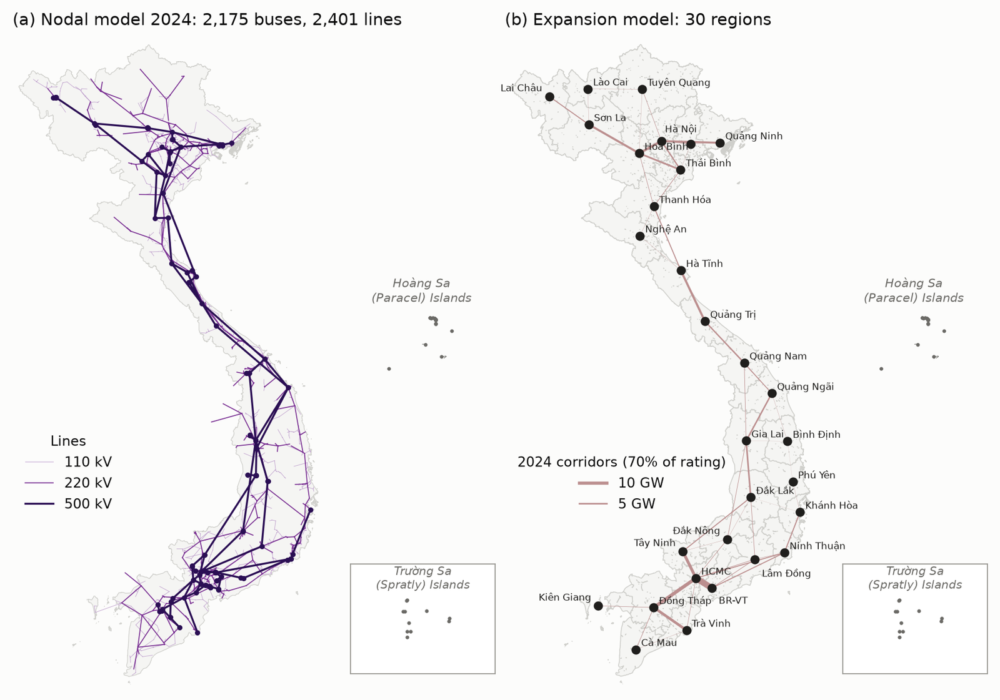
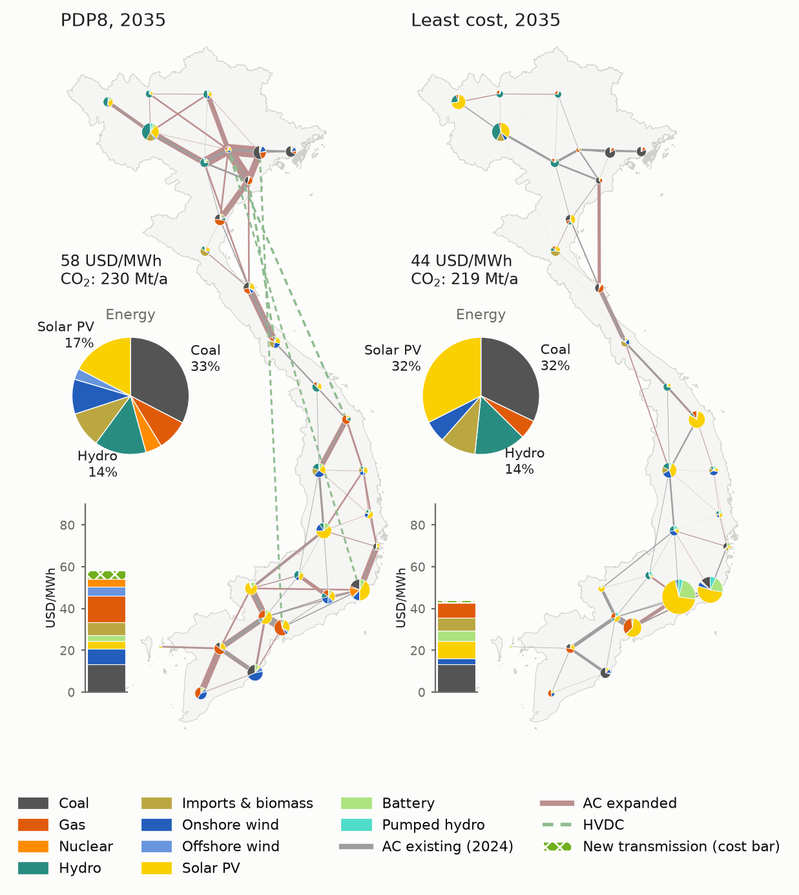
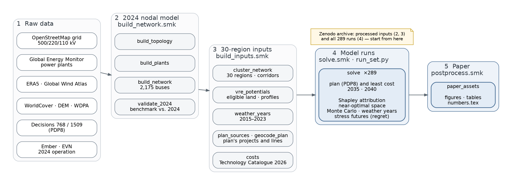

# PyPSA-VN-PDP8: An Open Capacity-Expansion Model of Vietnam's Power System

PyPSA-VN-PDP8 is an open model dataset of Vietnam's power system at the transmission network level. It compares the
revised Power Development Plan VIII (PDP8; Decision 768/QĐ-TTg and its implementation plan, Decision 1509/QĐ-BCT) with
a least-cost system for 2035 and 2040. Both systems must meet the same adequacy and security constraints. The gap
between them is attributed to the plan's components and tested with near-optimal, Monte Carlo, weather-year and
stress-test analyses. The model is built from open data using a Snakemake workflow and is fully open source. It is
designed to be imported into the open-source energy system modelling framework [PyPSA](https://pypsa.org).

> [!NOTE]
> PyPSA-VN-PDP8 is developed at the [Heudiasyc](https://www.hds.utc.fr) and Roberval laboratories of the Université
> de technologie de Compiègne, France, and at the University of Danang - University of Science and Technology,
> Vietnam.

Among many other things, the dataset consists of:

- A power grid model based on [OpenStreetMap](https://www.openstreetmap.org) for the 500, 220 and 110 kV levels.
- Power plants from the [Global Energy Monitor](https://globalenergymonitor.org) trackers.
- Electricity demand built from an hourly load shape, monthly totals of [Ember](https://ember-energy.org) and
  provincial electricity sales of 2024, scaled to the demand forecast of the plan.
- Renewable time series based on ERA5, assembled using [atlite](https://github.com/PyPSA/atlite), and ten weather
  years (2015–2024) for adequacy tests.
- Geographical potentials for wind and solar generators based on a land eligibility analysis with ESA WorldCover, the
  Copernicus DEM, protected areas (WDPA) and the Global Wind Atlas.
- The plan's capacity targets (Decision 768) and its generation projects and transmission lines (Decision 1509).
- Technology costs of the Vietnam Technology Catalogue 2026 and fuel prices of the 2025 price frameworks.

The 2024 transmission grid (500/220/110 kV, 2,175 buses) is shown in this map of the nodal model (left). For the
capacity expansion, the model is clustered to 30 regions, connected by the existing inter-regional corridors (right):

The image below shows the installed capacity per region and the transmission in 2035 of the plan and of the least-cost
system:

This diagram gives an overview of the workflow, from raw data to the summary of the 289 model runs:

# Warnings

PyPSA-VN-PDP8 is a research model and has several [limitations](https://nautel.github.io/pypsa-vn-pdp8/limitations.html)
that you should understand before using the model. The GitHub repository
[issues](https://github.com/nautel/pypsa-vn-pdp8/issues) collect known topics. The
[documentation](https://nautel.github.io/pypsa-vn-pdp8/) describes the installation, the workflow, the configuration and
the outputs. The processed inputs and all solved runs are archived on
[Zenodo](https://doi.org/10.5281/zenodo.24037833), so that the results can be used without the raw data or a solver.
The reference years are optimised separately, and the 30 regions are connected by a transport model without a
power-flow check, so the transmission results are indicative. A paper describing the model and its results is in
preparation.

# Contributing and Support

We welcome anyone interested in contributing to this project. If you have any ideas, suggestions or encounter
problems, feel invited to file issues or make pull requests on GitHub (see the
[contribution guidelines](CONTRIBUTING.md)).

- For **questions, bugs, corrections of input data and feature requests**, please use the
  [PyPSA-VN-PDP8 GitHub Issues page](https://github.com/nautel/pypsa-vn-pdp8/issues).
- For general questions about PyPSA, see the [PyPSA website](https://pypsa.org).

# Licence

The code in PyPSA-VN-PDP8 is released as free software under the [MIT License](https://opensource.org/licenses/MIT),
see [`docs/licenses.md`](docs/licenses.md). However, different licenses and terms of use may apply to the various
input data, see [`docs/data_sources.md`](docs/data_sources.md).
