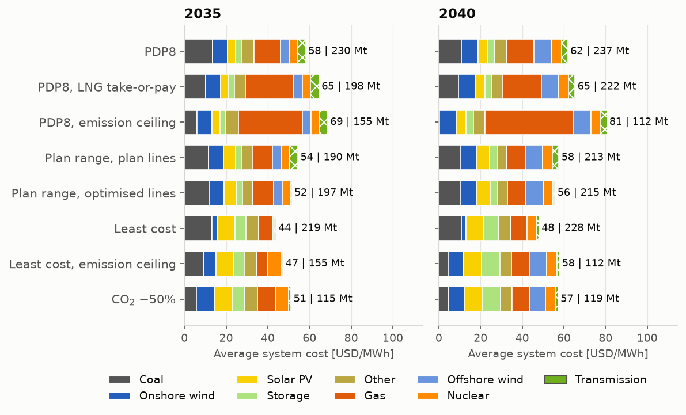
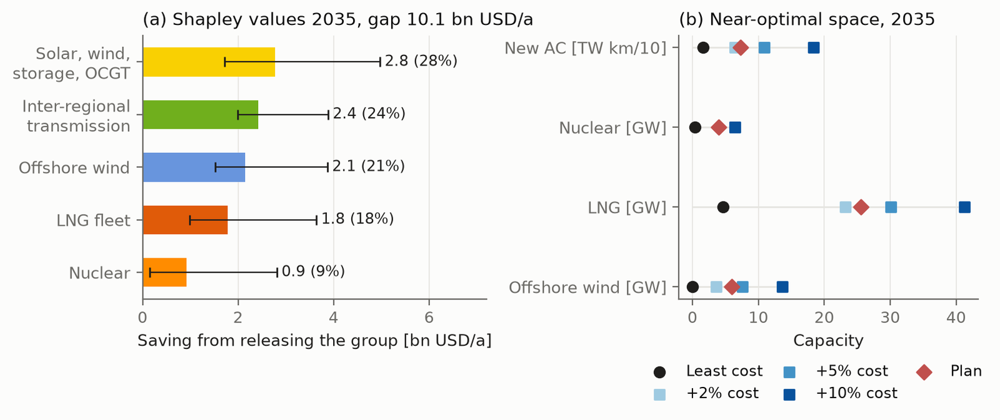

[](LICENSE)
[](https://doi.org/10.5281/zenodo.24037834)
[](https://pypsa.org)
[](https://snakemake.github.io)
[](https://www.python.org)

# PyPSA-VN-PDP8: planned versus least-cost power system for Vietnam

PyPSA-VN-PDP8 is an open capacity-expansion model of Vietnam's power system built with [PyPSA](https://pypsa.org).
It compares the revised **Power Development Plan VIII** (PDP8; Decision 768/QĐ-TTg of 2025 and its implementation
plan, Decision 1509/QĐ-BCT) with a **least-cost system** for 2035 and 2040. Both systems meet identical chronological
adequacy, operating-reserve and inverter-share constraints. The gap between them is attributed to the plan's
components with Shapley values and tested with near-optimal, Monte Carlo, weather-year and stress-test analyses.

The workflow reproduces every number, table and figure of the paper

> T. Le, H. C. Vu, M. Q. Duong, *Planned versus least-cost: Vietnam's power system and the revised Power Development
> Plan VIII*, submitted to Applied Energy (2026).

<p align="center">
  <br>
  <em>(a) Nodal model of the 2024 transmission grid (500/220/110 kV, 2,175 buses) built from OpenStreetMap;
  (b) the 30-region expansion model with the capacity of the existing inter-regional corridors.</em>
</p>

## Key results

Measured as cost incremental to the 2024 fleet:

- The least-cost system is **25% cheaper** than the plan in 2035 (10.1 bn USD/a, or 14 USD/MWh of demand) and
  **22% cheaper** in 2040. It builds far more solar power and storage, practically no offshore wind and practically
  no LNG capacity beyond the plants already committed.
- The largest shares of the gap stem from the plan's mix of solar power, wind and storage and from its
  inter-regional transmission. Offshore wind, nuclear power and the LNG fleet can each be accommodated within 5% of
  the optimal cost on their own.
- The advantage holds across 18 one-at-a-time sensitivities (18–27%), 32 Monte Carlo samples (20–30%), ten weather
  years with random outages and nine stress futures.

<table>
  <tr>
    <td width="44%"></td>
    <td width="56%"><br><br>
        </td>
  </tr>
  <tr>
    <td><em>Installed capacity per region and transmission in 2035: the plan (PDP8) and the least-cost system.</em></td>
    <td><em>Top: average system cost by technology and CO<sub>2</sub> emissions of the main scenarios. Bottom: Shapley
    values of the plan's components and their near-optimal space.</em></td>
  </tr>
</table>

## Model

| Feature | Implementation |
|---|---|
| Space | 30 regions, clustered from the nodal model; inter-regional corridors as a transport model; new AC lines and the plan's HVDC links |
| Time | three-hourly steps; every fourth day and the peak day of the year (weighted) |
| Investment | utility PV, onshore and offshore wind, batteries, pumped hydro, LNG-fired CCGT, OCGT, nuclear power, transmission |
| Security | chronological capacity reserve margin in every step (GenX-style), operating reserve, non-synchronous penetration ≤ 75% |
| Operation | linearised unit commitment of coal plants, monthly hydro budgets, take-or-pay offtake of domestic gas |
| Plan | capacity vector of Decisions 768/1509 (base and high variant), the plan's own transmission projects |
| Data | OpenStreetMap, Global Energy Monitor, ERA5 and Global Wind Atlas, ESA WorldCover, Copernicus DEM, WDPA, Ember, Vietnam Technology Catalogue 2026 |
| Analyses | Shapley attribution over all 32 subsets of five groups, near-optimal space at 2, 5 and 10% slack, Latin-hypercube Monte Carlo (32 samples), ten weather years with random outages, regret of five portfolios under nine stress futures |

## Workflow

<p align="center"></p>

The workflow is written in [Snakemake](https://snakemake.github.io) (`workflow/`):

| Rule file | Content |
|---|---|
| `rules/build_network.smk` | 2024 nodal model from raw data and its benchmark against observed operation |
| `rules/build_inputs.smk` | inputs of the 30-region model: clustering, land eligibility and VRE profiles, weather years, the plan's projects, costs |
| `rules/solve.smk` | the 289 model runs of the paper; settings and dependencies of every run in `scripts/run_set.py` |
| `rules/postprocess.smk` | analyses, figures, tables and number macros of the paper |

The processed inputs (steps 2 and 3) and all results (step 4) are archived on Zenodo, so that the paper can be
reproduced without the raw data.

## Installation

```bash
git clone https://github.com/nautel/pypsa-vn-pdp8.git
cd pypsa-vn-pdp8
conda env create -f workflow/envs/environment.yaml
conda activate pypsa-vn-pdp8
```

The runs of the paper used Gurobi 13 (barrier without crossover, relative tolerance 1e-4; free academic licences are
available). The open-source solver HiGHS can be selected in the configuration (`solver: {name: highs}`), but a run
then takes hours instead of minutes.

## Usage

1. Download the archives from [Zenodo](https://doi.org/10.5281/zenodo.24037834) and unpack
   `pypsa-vn-pdp8-inputs-v1.0.zip` and `pypsa-vn-pdp8-results-v6.zip` into the repository root (they create `data/`).
2. Download the GADM 4.1 boundaries of Vietnam (levels 0–2, GeoJSON) from <https://gadm.org> into `data/shapes/`,
   and the Paracel and Spratly outlines (`XPI`, `XSP`) into `data/shapes/islands/`. GADM data may not be
   redistributed and are therefore not included.
3. Run the workflow from `workflow/`:

```bash
cd workflow
snakemake -j1 paper_assets      # figures, tables and numbers of the paper from the archived runs (~10 min)
snakemake -j4 solve_all         # run the model runs that are missing (all 289 in an empty results directory)

# one run into a separate results directory (its dependencies are run first)
snakemake -j4 ../data/expansion/my_runs/2035_opt_vn_summary.json --config results=my_runs
```

With Gurobi and four threads per run, a typical run takes a few minutes (median 6 min, longest about 2 h); the full
set of 289 runs takes about 30 job-hours. Run names follow `<year>_<scenario><tag>` with scenario `pdp8` (the plan)
or `opt` (least cost); the tags are defined in `workflow/scripts/run_set.py`. Results are written to
`data/expansion/<results>/` and the paper assets to `results/paper/`.

All settings are in `workflow/config/config.default.yaml`:

| Key | Meaning |
|---|---|
| `data` | directory of the processed inputs and results (`VN_DATA`) |
| `results` | sub-directory of the run set (`results_v6` = runs of the paper) |
| `paper_assets` | output directory of figures, tables and `numbers.tex` |
| `solver` | `name` (`gurobi` or `highs`) and `threads` per run |
| `external` | data from other repositories, needed only to rebuild the nodal model |

### Rebuilding the inputs from raw data

`snakemake -j1 build_inputs` and `snakemake -j1 build_network_2024` rebuild steps 3 and 2. They require the
OpenStreetMap extract of Vietnam ([earth-osm](https://github.com/pypsa-meets-earth/earth-osm)), the Global Energy
Monitor trackers, an ERA5 cutout (Copernicus Climate Data Store account), downloads of WorldCover, the Copernicus DEM,
WDPA and the Global Wind Atlas, and the operator tables of transformer capacities included in the Zenodo inputs. The
sources of every dataset are listed in [`docs/DATA_SOURCES.md`](docs/DATA_SOURCES.md).

## Repository structure

```
├── workflow
│   ├── Snakefile
│   ├── config/config.default.yaml
│   ├── envs/environment.yaml
│   ├── rules/                 build_network, build_inputs, solve, postprocess
│   ├── scripts/               model.py (capacity expansion), run_set.py (run set), analyses and figures
│   └── repo_data/costs/       cost assumptions (Vietnam Technology Catalogue 2026, fuel price frameworks 2025)
├── data/                      processed inputs and results (Zenodo, not tracked)
├── docs/                      data sources, figures of this README
├── CITATION.cff
└── LICENSE
```

## Citation

If you use this model, please cite the paper and the archived release (see [`CITATION.cff`](CITATION.cff)).

## License

The code is released under the [MIT License](LICENSE). The archived data carry the licences of their sources; see
the README of the Zenodo archive.
