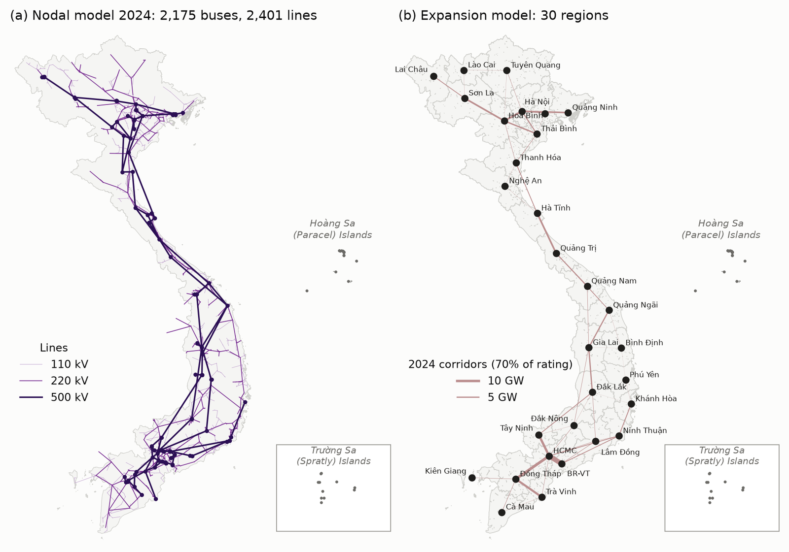

# PyPSA-VN-PDP8

PyPSA-VN-PDP8 is an open capacity-expansion model of Vietnam's power system built with [PyPSA](https://pypsa.org)
and [Snakemake](https://snakemake.github.io). It compares the revised Power Development Plan VIII (PDP8; Decision
768/QĐ-TTg of 2025 and its implementation plan, Decision 1509/QĐ-BCT) with a least-cost system for 2035 and 2040
under identical adequacy and security constraints. It also attributes the cost gap to the plan's components and tests
it with near-optimal, Monte Carlo, weather-year and stress-test analyses.



The workflow:

1. builds a nodal model of the 2024 transmission grid (500/220/110 kV) from OpenStreetMap and plant databases, and
   benchmarks it against observed operation;
2. clusters it into 30 regions and prepares their inputs (land eligibility, wind and solar profiles, weather years,
   the plan's projects and lines, technology costs);
3. solves 289 model runs: the plan and the least-cost system, together with all scenarios, sensitivities and
   analyses;
4. summarises the results in figures, tables and key indicators.

The processed inputs and all 289 solved runs are archived on [Zenodo](https://doi.org/10.5281/zenodo.24037834). The
results can therefore be used, and the summary rebuilt, without the raw data or a solver.

```{toctree}
:caption: Getting started
:maxdepth: 1

introduction
installation
tutorial
```

```{toctree}
:caption: Configuration
:maxdepth: 1

configuration
run_set
```

```{toctree}
:caption: Model and workflow
:maxdepth: 1

model
workflow
outputs
data_sources
limitations
```

```{toctree}
:caption: Project
:maxdepth: 1

release_notes
contributing
licenses
citation
```
