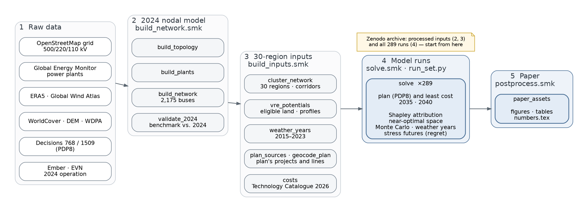

# Introduction

## Purpose

Vietnam's power development plan sets technology-specific capacity targets: solar, wind, offshore wind, LNG, nuclear
power, storage and inter-regional transmission. PyPSA-VN-PDP8 asks how much the plan costs compared with a least-cost
system that meets the same demand under the same adequacy and security standard, and which parts of the plan cause the
difference.

Two systems are built for each reference year (2035, 2040):

| Scenario | Name | Capacities |
|---|---|---|
| Plan | `pdp8` | fixed to the national targets of Decision 768 (low variant by default), distributed over regions with the provincial project lists of Decision 1509; the plan's transmission projects and HVDC links are added; dispatch only |
| Least cost | `opt` | committed assets as in the plan; utility PV, onshore and offshore wind, batteries, pumped hydro, LNG-fired CCGT, OCGT, nuclear power and transmission are optimised |

All costs are measured incremental to the 2024 fleet.

## Workflow



| Step | Snakemake rules | Result |
|---|---|---|
| 1 Raw data | none: downloads, see [installation](installation.md#rebuilding-from-raw-data) | OpenStreetMap grid, GEM plants, ERA5, GIS layers, the plan's decisions, 2024 operation |
| 2 2024 nodal model | `rules/build_network.smk` | PyPSA network of 2,175 buses and its benchmark against 2024 operation |
| 3 30-region inputs | `rules/build_inputs.smk` | clusters and corridors, VRE potentials and profiles, weather years, the plan's projects, costs |
| 4 Model runs | `rules/solve.smk`, `scripts/run_set.py` | 289 solved networks and run summaries |
| 5 Results summary | `rules/postprocess.smk` | figures, tables and `key_indicators.csv` |

Steps 2 and 3 need raw data from several sources, and step 4 needs a solver and about 30 job-hours. The Zenodo
archive therefore contains the outputs of steps 2–4, so a typical session starts at step 4 or step 5 (see the
[tutorial](tutorial.md)).

## Repository structure

```
├── workflow
│   ├── Snakefile
│   ├── config/config.default.yaml   workflow configuration
│   ├── envs/                        conda environments
│   ├── rules/                       build_network, build_inputs, solve, postprocess
│   ├── scripts/                     model.py (capacity expansion), run_set.py (run set), analyses and figures
│   └── repo_data/costs/             cost assumptions (Vietnam Technology Catalogue 2026, fuel price frameworks 2025)
├── data/                            processed inputs and results (Zenodo, not tracked)
├── docs/                            this documentation
├── tests/                           tests of the run set and the workflow
└── CITATION.cff
```
